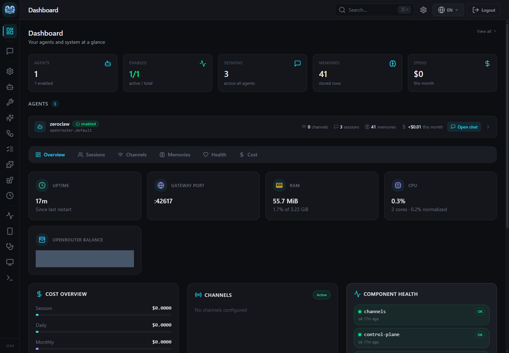
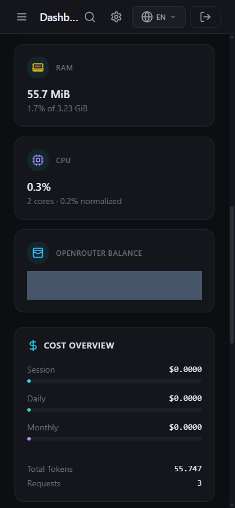

# OpenRouter balance dashboard evidence

Captured on 2026-10-18 from the real authenticated dashboard in a running Linux
deployment. These are browser screenshots, not generated images or isolated
component renders. The numeric balance and usage lines were masked during
capture, before the PNG files were written. No account identifiers, private
endpoints, credentials, or unredacted balance figures are included.

## Desktop — 1440 × 1000

The surrounding overview grid shows the card spacing, icon, label, alignment,
and dark-theme colors. The two financial text lines are deliberately obscured.

## Mobile — 390 × 844

The dashboard was scrolled to the balance card. The card uses the narrow layout
without horizontal document overflow. The existing tab strip scrolls separately.

## Provenance and limits

- The balance-card renderer is the one introduced by `0f965eee`; refreshing this
  branch onto `master` did not change `Dashboard.tsx` or its layout components.
- The deployment reports gateway version 0.8.6 and preserves that custom UI. Its
  credits route uses a local compatibility adapter because the upstream release
  does not yet include this PR's native endpoint. The captures prove the visible
  UI and successful ongoing use, not execution of this branch's Rust handler.
- The authenticated route returned numeric credit totals; an unauthenticated
  request returned HTTP 401. Reload preserved the authenticated dashboard.
- The visible Chrome session reported no JavaScript page errors.
- The native Rust handler and encrypted configuration path are checked separately
  by the focused Cargo checks and PR CI recorded in the PR description.
