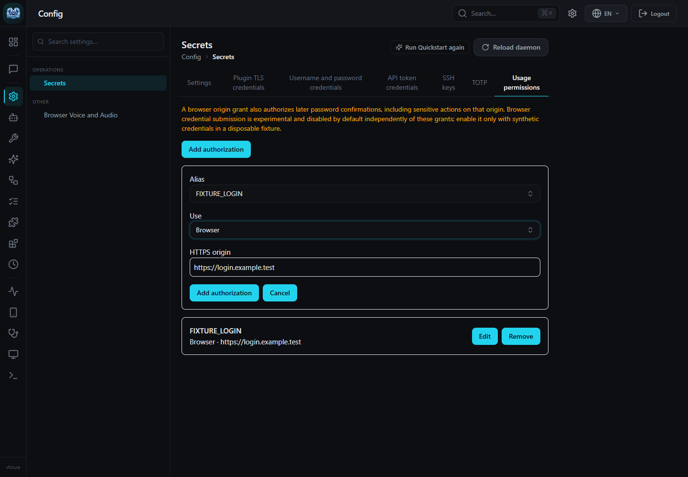

# Browser credential consumer design

This is a design for a follow-up to RFC #12422 and the extended credential catalog in #12517.

## Operator grants

In **Settings → Secrets → Permissions**, give username/password entries a browser-login grant and TOTP entries a browser-verification grant. Each grant defaults to denied and is scoped to an exact HTTPS origin, including its effective port. An operator can enable either grant or both independently. The HTTP Request grant stays independent. A destination change clears the affected browser grant. An unsupported backend shows that browser credential use is unavailable.

## Runtime boundary

The Permissions panel displays the scope warning before an operator adds or
edits a browser grant. This screenshot uses synthetic catalog metadata on the
production dashboard route, with the add-authorization editor open:

The screenshot was captured from `0ea4ccae0` in Chromium at 1440 × 1000, in
English. The dashboard HTTP metadata was supplied by a disposable fixture.
The fixture also saved an additional browser origin, reloaded the page, and
confirmed that the separate TOTP entry retained its empty grant list. This
validates the operator interface, not managed session isolation or login.

Use an isolated managed browser context and trusted, purpose-built login operations. The caller supplies an alias. The executor resolves it just in time from the existing catalog and configured vault. Treat the seed as a secret and keep generated codes inside the executor. A password operation and a TOTP operation check their own grants, including after redirects and on multi-step login flows. A challenge displayed by a page carries no authority. Bind both the active top-level origin and the receiving document and submission destination to the approved HTTPS origin. Reject unsupported frames, insecure transport, certificate errors and ambiguous destinations. Retain existing browser policies and operator approvals. A delegated or resumed task must pass the same checks against current policy.

Keep credential-bearing pages and browser session material out of generic snapshots, screenshots, downloads, script evaluation, and tool results during the credential operation. Verify that secrets never enter process arguments, diagnostics, telemetry, model context, or persisted browser profiles. Start with a backend that can enforce these properties and fail closed elsewhere. Return only a bounded status. A successful fill is distinct from successful authentication. Support a TOTP-only grant for a session already at a verification step. Keep browser sessions isolated by task and close them on termination.

## Acceptance tests

Use disposable HTTPS fixtures. Cover password-only, TOTP-only, both grants and neither. Exercise same-page and staged challenges, revoked grants, changed destinations, cross-origin redirects and frames, backend refusal, cancellation, clock rollover, local and external vault resolution, and absence of credential material in every agent-visible output. Keep existing HTTP and SSH grants independent.

## Integration status

The draft implements separate catalog grants and a Rust predicate over the top-level URL, credential document, and submission target. The predicate is evaluated against their HTTPS origins. It does not establish that the URLs were collected atomically or that the browser prevents subsequent script-driven transmission. Those guarantees belong to the managed browser executor. The ordinary fill action remains separate from the credential flow.

The initial acceptance sequence is a disposable HTTPS login with separate password and TOTP steps, followed by a read-only confirmation that the configured operator can reach their intended console. Live validation records the authentication outcome without copying account data, credentials, cookies, or identity-provider responses.

## Draft runtime implementation

The explicit `browser.credential_submission_enabled` switch defaults to `false`,
independently of origin grants and browser automation enablement. Saving a grant
does not enable `submit_credential`. The executor reads this switch from the same
on-disk config as the catalog before any browser or vault access and again after
an awaited lookup. Missing, unreadable, malformed or disabled config refuses use.
This is an experimental acceptance switch for disposable fixtures with synthetic
credentials, not a claim that the current executor provides managed isolation.
Disable it to stop subsequent releases without deleting grants. Environment-only
overrides cannot enable this disk-authorized path.

The action submit_credential takes one catalog alias on the active login page. The executor rechecks the catalog after vault lookup and sends values through standard input. The form helper accepts visible top-level fields and a same-origin HTTPS POST action. Its result indicates submission, not authentication. This implementation targets standard HTML forms and six-digit SHA-1 TOTP with a 30-second step.

### Multi-step and embedded forms

Use credential_stage to select username, password, login, or otp. A username-only call does not fetch the password. Use credential_field for a field observed on the page, or for a group of one-character OTP controls. Use credential_frame for a single visible iframe when its document and the top-level page share the authorized HTTPS origin. Each submission still requires the form to send a POST to that origin. A cross-origin login embedded by a site must be opened through its normal sign-in navigation before the tool can use a grant for that other origin. Provider access checks remain separate from credential submission.

## Current limitations

This remains draft pending RFC #12422 and its catalog dependencies. The current agent-browser path does not yet isolate browser sessions by task or suppress generic observations of credential-bearing pages. Origin grants authorize later password confirmations on that origin, including sensitive operations. A submission acknowledgement does not prove authentication. A refused or unconfirmed result may follow a page-handled submission; inspect page state rather than automatically retrying.

Every permission mutation requires the accepted catalog revision. Replacing a credential with a different suggested service clears HTTP and browser grants; rotation for the same service preserves them. A named OTP field must also match `autocomplete="one-time-code"` or `name="otp"`; a group must have one character per control.
